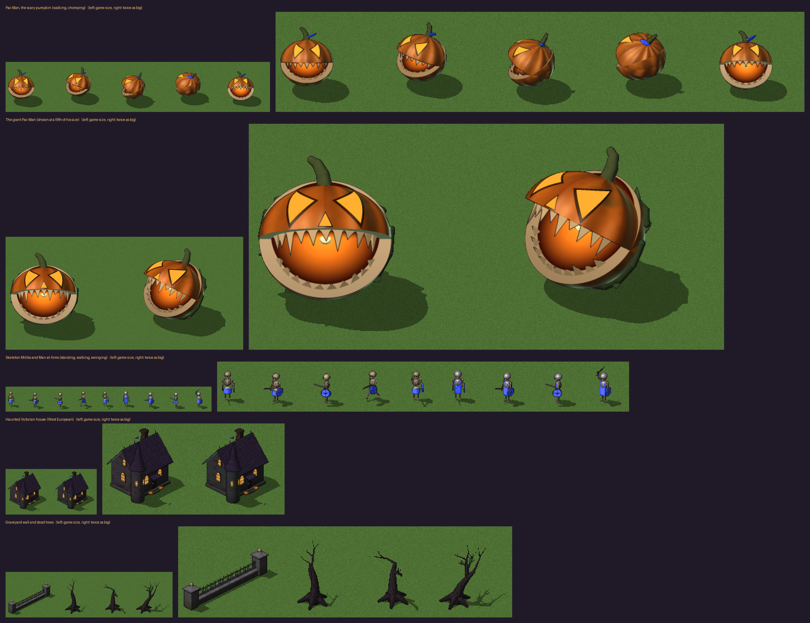
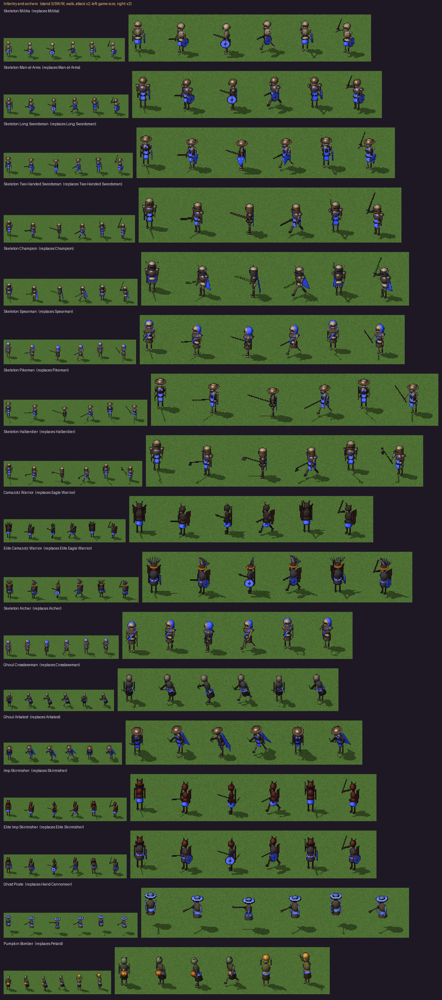
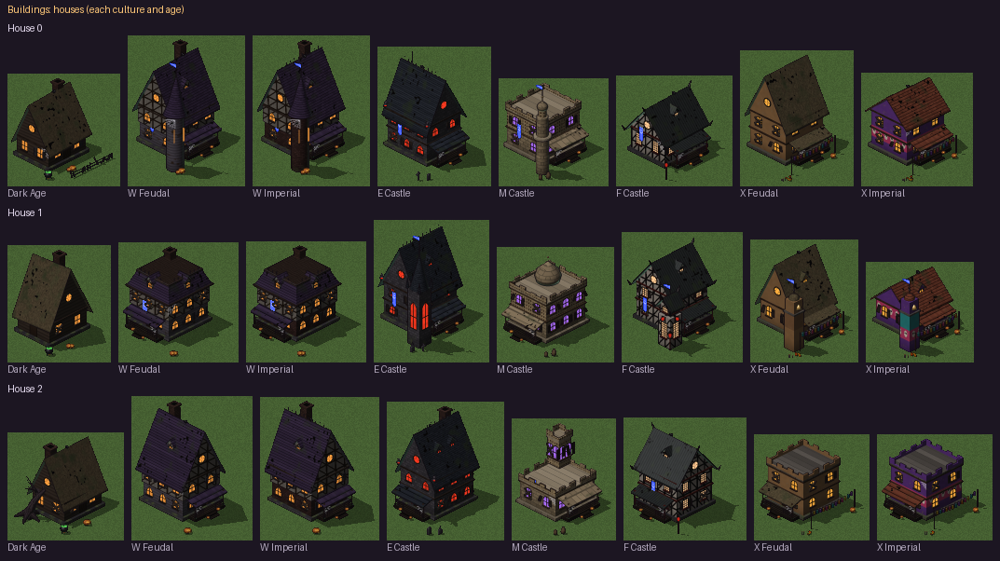
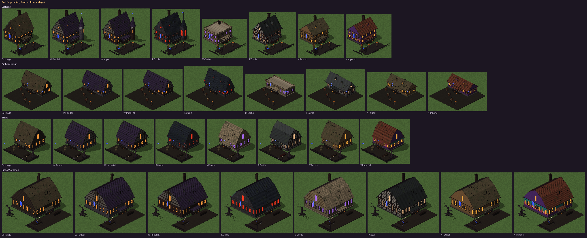
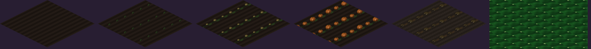
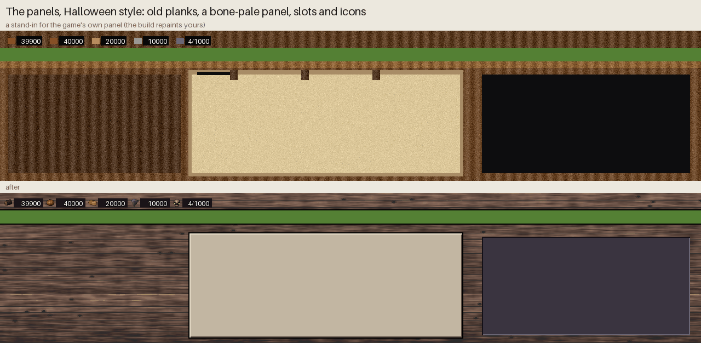
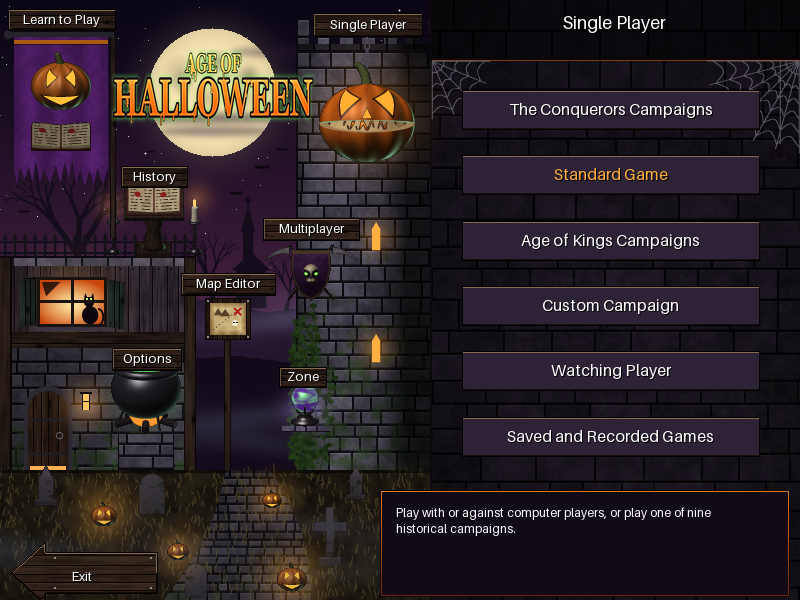
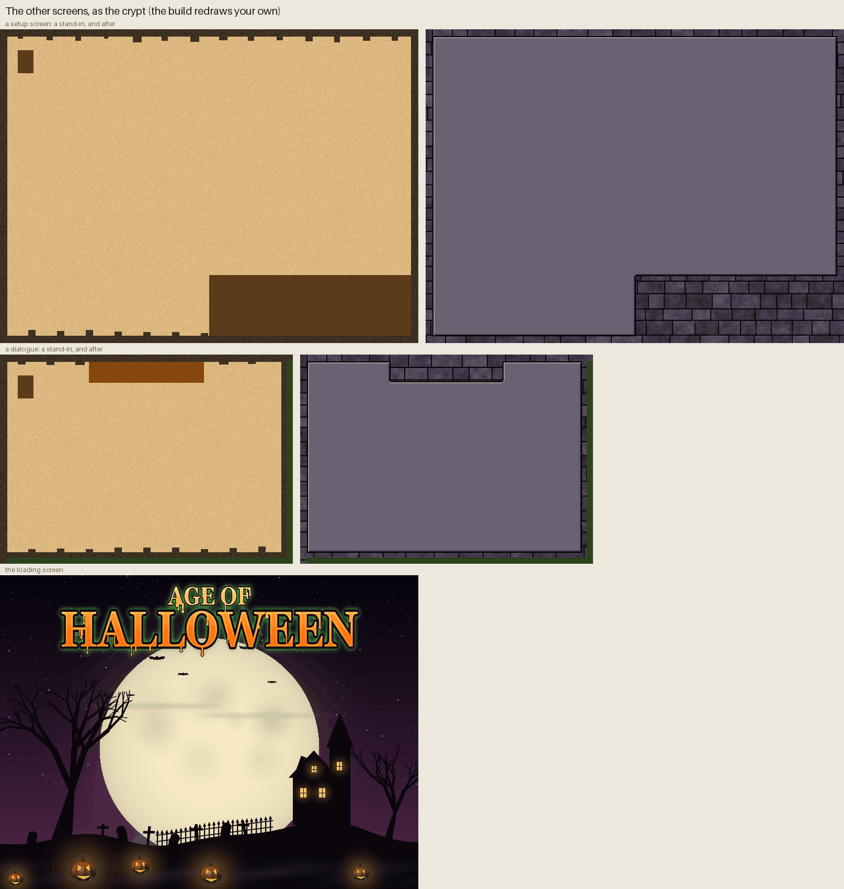
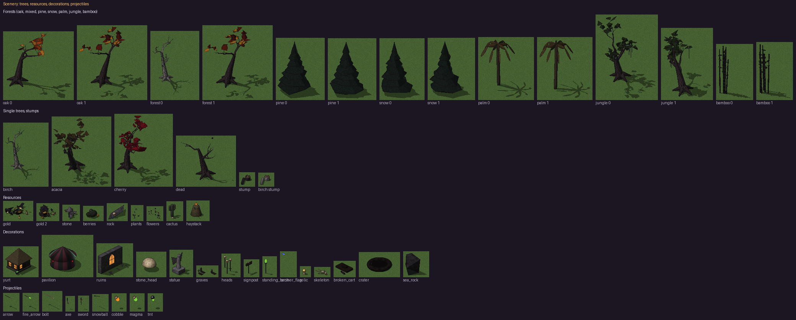
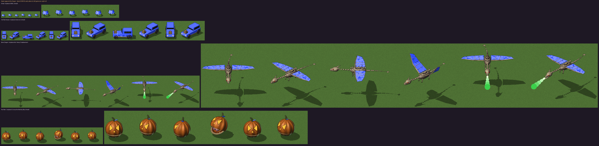

# Age of Halloween — design

A graphics mod for **Age of Empires II: Gold Edition** (The Age of Kings +
The Conquerors) that turns the whole game into a Halloween night: zombie
villagers, skeleton armies, death knights on nightmares, ghost ships, haunted
houses in five haunted cultures, pumpkin patches, a churchyard menu, and Pac-Man
as a scary jack-o'-lantern. Gameplay stays the same; only the pictures change
(and the names and texts of the mod's own extra units).



## Art direction

| Rule | Value | Why |
|---|---|---|
| Look | smooth, detailed figures: real curves (spheres, rods, turned shapes), not blocks or pixels | the player asked for "as detailed as possible, not pixelated like Minecraft" |
| Mood | "darker and creepier": dim moonlight, a sickly green rim light, drained colours, grime | the player's choice after seeing a first, brighter cartoon look |
| Glows | carved pumpkin faces, eyes, windows, candles, lanterns and green fire stay bright | they are what you see first in the dark |
| Scale | the same sizes as Age of Minecraft's sprites: infantry about 45 px tall, ships 2.4 times bigger than people | each sprite fills the room the game gives it |
| Camera | orthographic, looking down at 30° (AoE2's view) | sprites sit correctly on the terrain |
| Smoothing | 3 × 3 samples per pixel (2 × 2 for the giant), dark ink lines where shapes overlap | clean edges at AoE2's small sizes, in its 256 colours |
| Shadow | a ground shadow toward the lower right, as SLP shadow pixels | AoE2 blends shadows itself |
| Team colour | 8 shades per player: sashes, tabards, cloaks, sails, banners, plumes and flags | AoE2 swaps these palette ranges per player |

Every picture is generated by code from shapes and materials (`sculpt.py`,
`paint.py`): no image files from anywhere are used.

## Units

All units are modelled; the complete list is in [UNITS.md](UNITS.md). Each
group has a preview sheet, `previews/cast_<group>.png`.



| Group | Halloween take |
|---|---|
| Villagers | zombie villagers in rags, each job with its tool and its load (logs, ore, pumpkins, meat, fish) |
| Monk / King | a hooded necromancer with a skull staff / a vampire lord in a high-collared cloak |
| Swordsmen, spearmen | skeleton soldiers whose armour gets better each age |
| Archers | skeleton archers; crossbowmen are ghouls; skirmishers are imps with javelins |
| Eagle Warriors | Camazotz bat-men |
| Hand Cannoneer, Petard | a ghost pirate / a pumpkin bomber, a zombie carrying a lit jack-o'-lantern bomb |
| Cavalry | zombie and skeleton riders on bone horses (scout line), death knights on nightmares (knight line); the Paladin is the Headless Horseman, a jack-o'-lantern in his hand |
| Cavalry archers, camels | skeleton and wraith horse archers; mummy camel riders and lancers |
| Siege | coffin rams on skeleton legs, bone catapults, bone ballistae, a gargoyle-mouthed bombard glowing green, a gallows trebuchet with a coffin for its counterweight and a pumpkin in its sling |
| Ships | ghost ships of black, rotting planks with torn sails in the owner's colour and green lanterns; the transport is a ferry of the dead, the demolition ship a floating coffin of powder kegs |
| Unique units | Longbowman → spectral archer · Woad Raider → banshee · Chu Ko Nu → jiangshi · Throwing Axeman → werewolf · Huskarl → draugr · Samurai → ghost samurai · War Elephant → elephant skeleton · Teutonic Knight → death knight · Janissary → mummy musketeer · Berserk → werewolf berserker · Jaguar Warrior and Plumed Archer → Day of the Dead calaveras · Cataphract → revenant · Mangudai → ghost rider · Mameluke → mummy · Tarkan → ghoul raider · Conquistador → phantom · War Wagon → hearse · Longboat → draugr longboat · Turtle Ship → the shell of a dead sea turtle |
| Animals | nightmare horses, dire wolves with glowing eyes, black sheep, skeletal stags, demon boars, vultures, giant bats, ravens, shadow panthers, bone and ghost fish |

## Buildings



Every building stands on its footprint at the game's size (a 2 × 2 house, a
3 × 3 barracks, a 4 × 4 castle, a 5 × 5 wonder), and the walls the camera sees
carry its doors, lit windows and decorations.

### Five haunted cultures, four ages

AoE2 gives every civilisation one of five building sets, plus one Dark Age
look for everyone. Each becomes a haunted culture, built in its own way:

| Set (civilisations) | Haunted culture |
|---|---|
| Dark Age (everyone) | crooked log cabins under rotting thatch, mossy stones, a lantern by the door |
| West European (Britons, Franks, Celts, Spanish) | haunted Victorian: peeling clapboard, then half-timbering, then soot-black brick; steep purple shingle gables with iron cresting, witch-hat turrets, pumpkins on the steps |
| Central European (Goths, Teutons, Vikings, Huns) | Transylvanian gothic: dark stone, pointed windows lit blood red, needle spires |
| Middle Eastern (Byzantines, Persians, Saracens, Turks) | mummy tombs: sandstone with bands of hieroglyphs, flat roofs and domes, green tomb light |
| East Asian (Japanese, Chinese, Mongols, Koreans) | ghost lanterns: black timber and paper walls, curved tile roofs, red paper lanterns |
| Mesoamerican (Aztecs, Mayans) | Day of the Dead: brightly painted plaster, stepped terraces, marigolds and candles |

### Building mapping



| AoE2 building | Haunted |
|---|---|
| House | a haunted home in its culture's manner, three variants like the game's three house pictures |
| Town Center | the village's great hall and its tower, flags and a graveyard by the gate |
| Mill | a windmill with tattered sails turning, sacks and a pile of pumpkins |
| Farm | a pumpkin patch (see *Farms* below) |
| Lumber / Mining Camp | an open shed with dead logs and an axe in a stump / a shed, a cart heaped with ore, a skull on a post |
| Barracks | a hall with a training yard of pumpkin-headed dummies and a weapon rack |
| Archery Range | a long shed and straw targets painted with skulls, shot full of arrows |
| Stable | a long barn, an iron-fenced paddock, hay, a trough of black water, a horse skull |
| Blacksmith | a smithy with a great chimney, its forge burning green, green smoke rising |
| Market | a trading hall and stalls under awnings in the owner's colour |
| Monastery | the culture's house of the dead, in a graveyard: a gothic chapel, a black church with a needle spire, a domed mausoleum, a temple with a torii gate, an ossuary chapel |
| University | a necromancer's academy with an observatory, a brass orrery of skulls turning on top |
| Siege Workshop | a big barn, a half-built bone catapult and stacks of coffins |
| Dock | a pier of black planks, a boathouse, a crane with a cage, lanterns |
| Fish Trap | black stakes and a sagging net with bony fish in it |
| Towers, Outpost | taller and stouter each level, with battlements and spires; the outpost a black post with a crow's nest, a green lantern and a raven |
| Walls | black sharpened stakes, skulls stuck on some / a mossy graveyard wall with an iron railing of spears / a tall dark rampart with merlons, iron spikes and a walkway, in the culture's colours; ends and corners are pillars, so every wall line joins up |
| Gates | a gothic arch with a spiked iron portcullis, down when shut and up when open, between two towers |
| Castle | a keep inside curtain walls with four towers and a gatehouse, in the culture's manner |
| Wonders | one per civilisation, haunted: a gothic cathedral, a vampire lord's castle on a crag, a necropolis under a great dome, pyramids, a Day of the Dead step pyramid, a cursed pagoda, a stave church, and more |
| Building sites, rubble | dug earth and black scaffolding / broken stones, charred beams, a skull, embers |

All the sheets: `previews/town_*.png` (houses, halls, military, economy,
forts, walls, wonders, building sites).

### Farms



In The Conquerors a farm is not a sprite: it is part of the ground, a terrain
texture in `terrain.drs`. There are five: three stages while a villager builds
the farm, the finished farm and the exhausted farm. Each becomes a pumpkin
patch on dark, furrowed earth:

| AoE2 | Haunted |
|---|---|
| Farm being built (three stages) | fresh furrows, then sprouting vines, then vines with small green pumpkins |
| Farm | big ripe orange pumpkins among the vines |
| Exhausted farm | cracked earth and rotten pumpkins |

The game picks one texture tile per map tile, so the pattern repeats every
tile and the tiles always join up. Each tile keeps the original tile's exact
shape, so a farm's edges still blend into the grass as before.

### Witch's brew

The game has a leftover terrain no map uses: terrain 15, "Old Water". It has
no texture of its own (the game draws it with the Water's), and every unit
treats it exactly as water: ships sail on it, Fish Traps work in it, soldiers
cannot walk on it. `lava.py` makes it a sea of glowing green **witch's brew**,
in place in the `.dat`: its own texture (swirls of green, bubbles with bright
rims, froth, cut into the Water texture's tile shapes), green on the minimap,
and blended into the ground around it the way the Water is. The game's palette
has few plain greens, so the brew also uses the green and the yellow player's
shades as plain colours that stay the same in every game. A Dock may only
stand on Water or Shallows next to a beach, so the Shallows in that rule
becomes the brew (no standard map has a Dock in a ford).

The **Witch Brew Islands** map is a random map script written from scratch,
close to the game's Team Islands: the whole map is brew, each team's lands are
joined into one island, and every island has a beach to build Docks on. There
are no fish; each island gets more berries, deer, boar and sheep. The build
writes the map into the mod's `Script.RM` folder, where the game lists a mod's
custom maps (with `build_mod_direct.bat`, into the game's `Random` folder,
which `restore_original.bat` empties of it again).

### Witch's cauldrons

Villagers can build a **cauldron** in the brew by their island's beach, and it
spits blobs of boiling green brew at enemies in range. The game has a tower
made for the sea that it never lets anyone build, the Sea Tower; `volcano.py`
(the code still calls it the volcano, as in Age of Minecraft) makes it the
cauldron, in place in the `.dat`, for every civilisation:

- **Where.** Villagers build it (on their military build page), the way they
  build a Dock: in the brew next to a beach, with brew under its middle. It is
  three tiles across, as big as a Barracks: 150 stone and 100 gold, 1 minute to
  build, 1500 hit points.
- **How it fights.** Every 3 seconds, at a tower's range (8 tiles), it boils
  over: a fountain of brew, and a blob lobbed high at the enemy, ship, unit or
  building. A blob does 12 piercing damage, 18 more against ships and 15 more
  against buildings. It is still a tower to the game, so the tower upgrades
  reach it (Fletching, Bodkin Arrow, Bracer, Masonry, Architecture), and Heated
  Shot makes it hit ships harder.
- **Its look.** A great iron pot on rocks over green-blue fire, bone handles,
  brew bubbling over the rim, fumes, and a flag in its owner's colour. Its
  three pictures (at rest, boiling over, the blob with a skull in it) and its
  icon are new.

### The ghost train and its rails

The Trade Cart is a **ghost train**: a black steam engine with a cowcatcher of
bones, its firebox glowing green, drawn 1.6 times its size, and it lays its own
rails. Right-click another player's Market and rails appear behind the train
all the way there, round whatever it drives round. The game cannot place rails
for a unit, but it can leave a picture on the ground behind a moving unit, as
carts leave wheel tracks in the snow. `rails.py` uses that, in place in the
`.dat`:

- **The train's ground rule.** The train keeps the Trade Cart's row of the
  terrain table, so it goes, and finds its way round things, exactly as the
  Trade Cart did; the row now leaves a piece of track on every terrain. The
  siege weapons that shared it take the foot soldiers' and cavalry's row,
  which lets units onto exactly the same ground. Computer players' trains
  trade as before.
- **The track** is the game's own cart tracks with a new picture: a short
  straight piece of rails behind the train (never ahead of it), so rails only
  lie where the train went. Like the wheel tracks in the snow, a piece fades
  and is gone 30 seconds after the train passed. A piece may not last a minute
  or more: the game keeps track of everything left on the ground in a clock of
  60 one-second places and files a longer one past its end, over other things
  in memory, so the game closes a little later (Age of Minecraft's builds whose
  pieces lasted a day, then 5 minutes, closed so). The build refuses to make
  cart tracks that last a minute or more.

The game's texts call it the **Ghost Train**.

### The panels



The resource bar at the top of the screen and the panel at the bottom
(commands, the selected unit's details, the minimap) are one picture per
civilisation and screen size in `interfac.drs`. UserPatch builds its
widescreen panels from the same pictures. The build repaints each one, every
pixel keeping its place:

| AoE2 | Haunted |
|---|---|
| Parchment (where the game writes the unit's details) | an old, bone-pale panel with a black edge, light along its top left and shade along its bottom right |
| The resource bar (the game writes the amounts in white) | one layout in every picture: each icon the same size, in line, and 2 pixels after it a flat, nearly black box, wide enough for "4/1000" |
| Dark areas (behind the minimap) | a dark slot, sunk in |
| Carved frames | weathered dark planks, as dark or light as the original frame, so the game's text stays readable |
| Resource icons: wood, food, gold, stone, population | a log, a pumpkin, a stack of gold coins, a rough stone, a skull, all as big |
| Where a panel meets the game view | a black edge |

Every panel picture has the same bar: an icon every 77 pixels, each followed
by a dark box. A picture whose boxes aren't there keeps its original look, so
no resource loses its icon. UserPatch draws a food icon of its own over the
bar's (a steak on a black square); the build redraws it as the bar's pumpkin,
in the same place, with nothing around it.

### The main menu



The main menu is one 800x600 picture (`interfac.drs` 50189) with, for every
button, pictures drawn over it at its place. Age of Halloween's menu is a
churchyard at night: a full moon behind the **AGE OF HALLOWEEN** title (orange
letters dripping, a green glow round them), a haunted house with a black cat in
its lit window and an iron railing round its roof, a round stone tower with
ivy and glowing arrow slits, a church and bare trees on the hills, mist,
gravestones and jack-o'-lanterns. Each button is a Halloween thing in the
original's exact place, and every button name is on a board of dark planks,
written in white. While the mouse is on a button its thing turns darker (no
glow), as the player asked for Age of Minecraft.

| Button | Haunted |
|---|---|
| Learn to Play | a tattered purple banner with a jack-o'-lantern and a spell book |
| Single Player | a big jack-o'-lantern with the giant Pac-Man's mean grin, hanging on a chain |
| History | a spell book open on a lectern between two candles |
| Multiplayer | a purple shield with a glowing-eyed skull, on two crossed scythes |
| Map Editor | an old map in a frame on a post: a dotted way past a skull to a red cross |
| Options | a witch's cauldron of bubbling green brew |
| Zone | a crystal ball of swirling green and purple mist |
| Exit | an arrow-shaped board of dark planks |

The right side, where the Single Player menu opens, is a dark stone wall with
cobwebs in its corners (a spider hanging from one), and the game draws that
menu's buttons dark purple, with white names, pumpkin orange under the mouse.
The description of a button is in a near-black box with an orange edge. The
menu has colours of its own: the original ones were made for a night in the
snow.

### The other screens and the loading screen



Every other screen (game setup, history, achievements, the dialogues in the
game) is described by a small screen file in `interfac.drs`. The build finds
them all, lists them in the report and saves them as `screen_originals\`.

Almost all of them are parchment, and the game writes on it in white, in cream
with a black shadow, in black, or in the players' colours. The **crypt** makes
each sheet a window in a middle purple-grey where all of those can be read,
with straight edges, a light and a dark edge. Everything around the windows of
one picture is one material, never a mix: dark old stone blocks, or weathered
planks for the campaigns' dialogues and the achievements. The achievements are
a dark window with a light panel where the scores are written in each player's
colour; their tabs are plain tabs, the flags the players' names are written on
become cloth banners in the flag's own colour with a grey stripe for the name,
and the team marks are shields in each team's pattern (bone white, blood red,
black).

The loading screen is a Halloween title card: a huge pale full moon in the
middle (where the game writes its loading text in black), the title at the
top, and against the moon a churchyard on a hill, a bare crooked tree, crosses
and gravestones, an iron fence and a haunted house with lit windows, bats, and
jack-o'-lanterns glowing in the grass. Only this screen uses its palette, so it
gets a palette of its own made from the new picture.

The mod's own exe says **Age of Halloween** in its window and on the taskbar,
and its icon is the giant Pac-Man's jack-o'-lantern.

### Nature and decorations



| AoE2 | Haunted |
|---|---|
| Forests | twisted oaks, bare or in sparse autumn leaves (orange, rust, blood red); pale ghostly birches; black spruces, frosted on snow; dead palms; jungle trees hung with moss and glowing mushrooms; black bamboo. Each tree grows to the height of the original, so forests keep their look |
| Chopped trees | a broken stump, splinters and logs |
| Gold / Stone mines | a broken coffin spilling coins and a skull among gold-veined black rocks / a heap of grey rock and old gravestones |
| Forage bushes | thorny black brambles heavy with dark berries |
| Map decorations | dead grass and glowing mushrooms, black roses, witch's huts, carnival tents, ruined chapels, giant stone skulls, a weeping angel, skulls on pikes, green torches, tattered banners, the relic as a cursed golden skull |

### Easter eggs



**Pac-Man** takes Furious the Monkey Boy's slot (unit 860) and is a scary
jack-o'-lantern: a carved, candle-lit pumpkin whose top half opens like a jaw,
showing two rows of teeth, as he runs and bites. The Wonder trains him (500
food, 500 gold, 5 minutes, 250 hit points, faster than any unit); he boards
Transport Ships and gets the infantry upgrades. His icon, sounds and name are
Age of Minecraft's (they took many rounds of testing in the player's game).

The "to smithereens" cheat's Saboteur is the **giant Pac-Man**: an older,
rotting pumpkin with vines creeping over it, a meaner grin and more teeth,
wider and taller than a Castle and a Wonder side by side. He has Pac-Man's
bite, armour and sounds, 10000 hit points, and no longer blows himself up.

The VDML cheat's unit is a bedsheet **ghost** in the owner's colour, and the
Cobra Car a **hot-rod hearse** with flames painted on its sides.

The Wonder also trains a **Bone Dragon** (300 food, 300 gold, 2 minutes, 600
hit points), in the slot of the never-used Advanced Heavy Crossbowman: a
dragon's skeleton on tattered wings in the owner's colour, green fire in its
ribs and eyes. It is always in the air, flies over land and water, and
breathes balls of green fire with a burning skull in them (40 damage every 3
seconds, range 6). Its icon is its bony head breathing green fire; its roars,
wing beats and fire are Age of Minecraft's dragon's sounds.

## Animations

AoE2 needs a set of sprites for each unit: **stand, walk, attack, die and
decay**, and villagers also walk while carrying. Each animation is stored for
5 directions (S, SW, W, NW, N); the game mirrors those to get NE, E and SE.
Because the figures are 3D models, every direction and frame is drawn
automatically. Each unit has a rig (how its body moves) and an attack style:
swordsmen swing overhead, spearmen stab, archers draw and release, the
necromancer raises both arms, rams butt forward, the trebuchet's coffin drops
and its arm throws over the top.

## Pipeline

```
models (shapes + materials)  ──draw──▶  frames (colour + team-colour mask + shadow)
        ──quantise──▶  AoE2 palette indices  ──encode──▶  .slp files
        ──import──▶  the mod's gamedata_x1_p1.drs  (on the player's PC)
```

1. **Draw** (`tools/aoh/sculpt.py`). A ray tracer draws the models from the
   AoE2 camera: exact spheres, rods, turned shapes and blocks, cut by planes,
   with the night's light. It keeps each pixel's kind (solid, team colour,
   shadow, outline) separate, so the output converts exactly to SLP.
2. **Quantise** (`palette.py`). Solid colours snap to the game's own
   256-colour palette, nearest colour in CIELAB. Team-colour pixels become the
   8 player-colour shades.
3. **Encode SLP** (`slp.py`). SLP 2.0N frames with the hotspot at the unit's
   feet.
4. **Match the original** (`build_mod.py`, on the player's PC). For each
   original sprite, the frame count, angle count and mirroring are read from
   the player's own files, and the sprite is drawn in exactly that layout.
   Extra layers of composite sprites (ram heads, sails, building shadows, roof
   pieces, flags) are blanked. The farm textures are found in the `.dat`'s
   terrain table, and each of their tiles is redrawn in exactly the pixels of
   the original tile.
5. **Install** as a UserPatch 1.5 data mod, a game of its own called Age of
   Halloween: `Games\age_of_halloween.xml`, and in
   `Games\age_of_halloween\Data\` its own `empires2_x1_p1.dat`,
   `language_x1_p1.dll` and `gamedata_x1_p1.drs` (every changed sprite, farm
   texture, panel, menu picture, icon and sound). `SetupAoC.exe
   -g:age_of_halloween` makes `age2_x1\age_of_halloween.exe` once, and an "Age
   of Halloween" shortcut with the jack-o'-lantern icon starts it. Age of
   Halloween and Age of Minecraft install side by side.

See [INSTALL.md](INSTALL.md) for how to run it.
